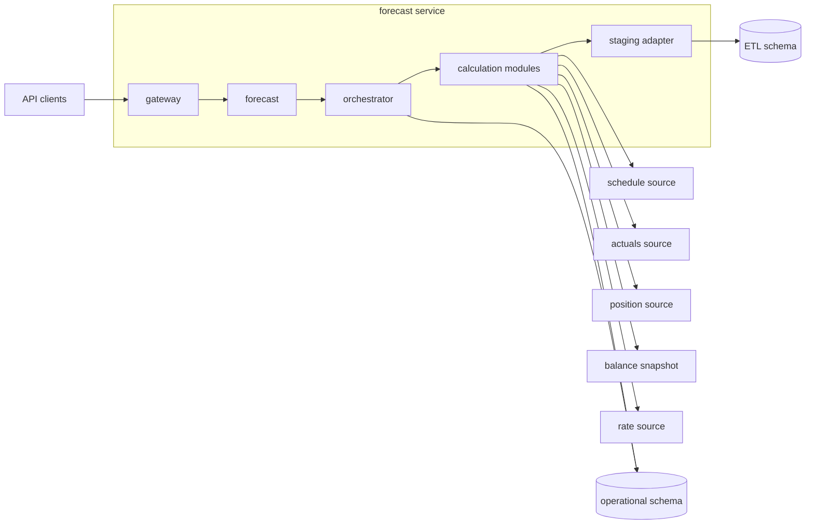
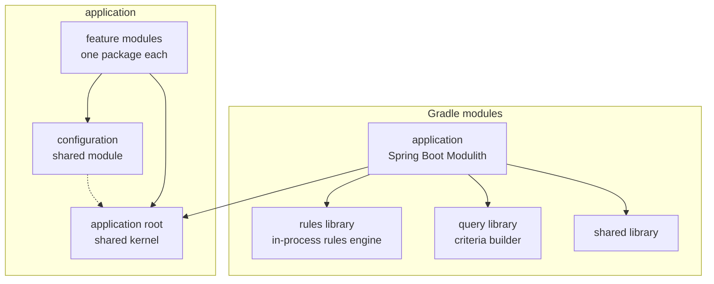
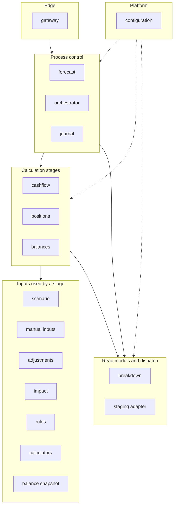
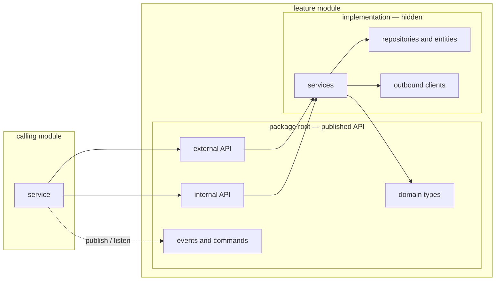
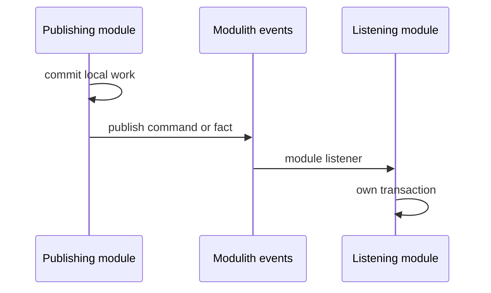
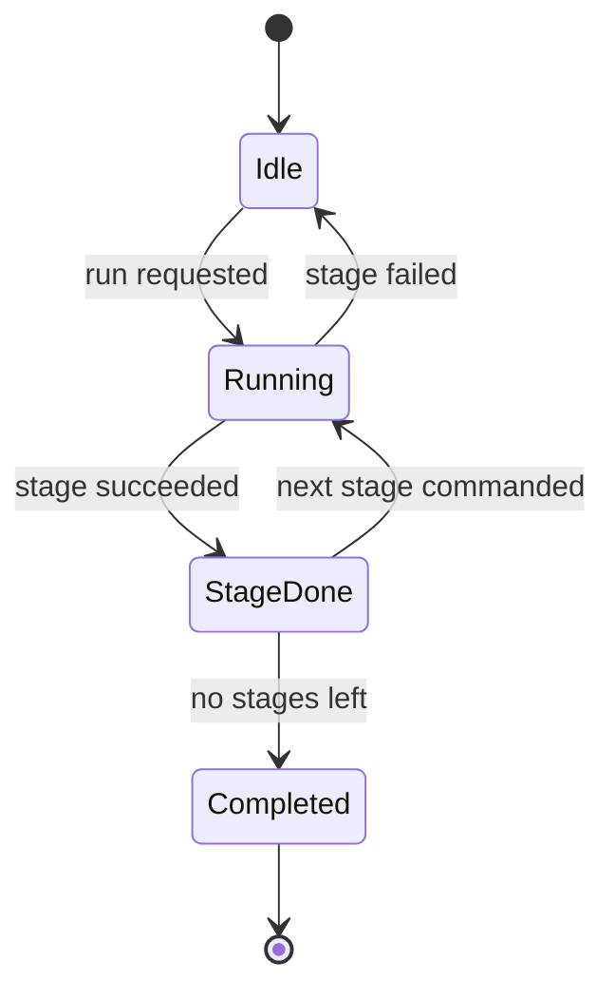
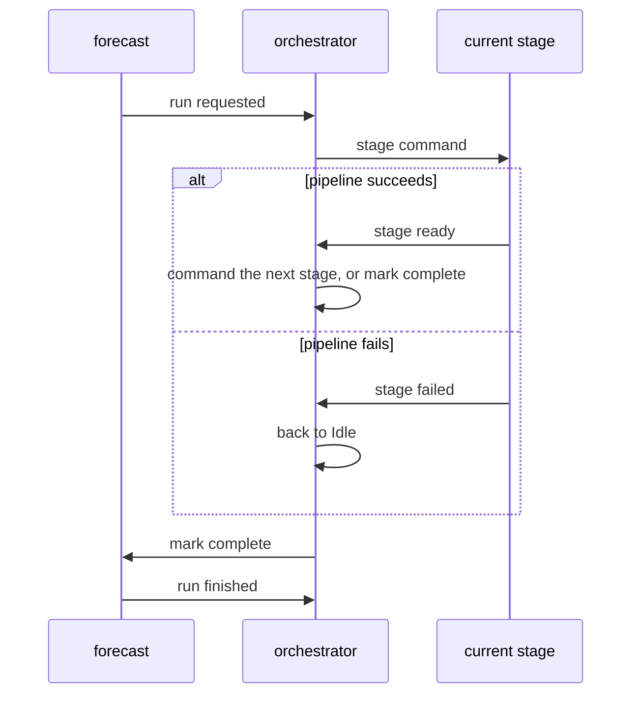
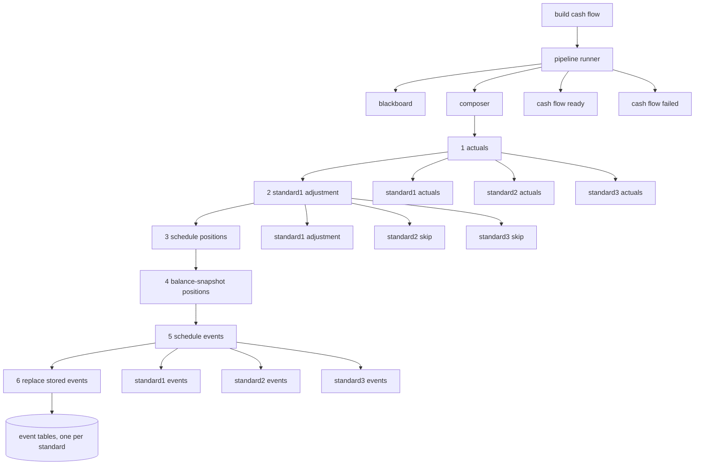
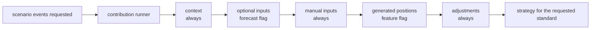
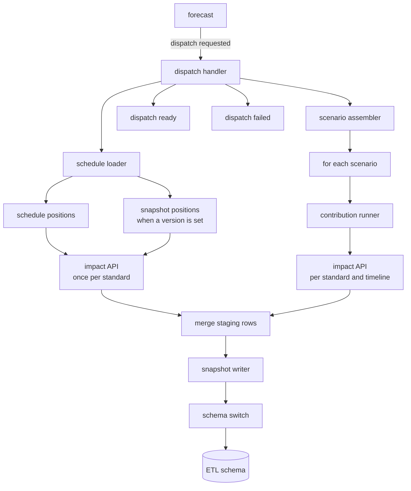

# Forecast service — architecture

A modular monolith that builds an operational forecast, then stages a snapshot for business intelligence.

One deployable Spring Boot application is split into Spring Modulith modules. Modules collaborate in two ways: a synchronous call through a published API, and an asynchronous command or fact published as an application event. A persisted state machine owns the run. Cash-flow construction and BI staging are pipelines assembled from small ordered steps.

A forecast selects which liquidity standards to calculate: **standard1**, **standard2**, **standard3**. Every pipeline includes only the branches for the selected set.

## 1. System context

The service owns the forecast lifecycle. Source systems stay behind clients inside the modules that need them. BI does not read the operational tables. A dispatch writes a snapshot into a separate ETL schema.

## 2. Build and runtime shape

Gradle keeps reusable libraries out of the application. The application itself is one Modulith: each direct child package of the application root is a module. `configuration` is the only shared module, so every module may depend on it. A few types in the application root — the standard enum, the timeline, the data-type enum — are the shared kernel.

The Modulith declaration lists `configuration` as a shared module. Bean names are fully qualified because several modules declare a listener, an assembler, and a step type with the same simple name.

## 3. Modulith map

Modules are grouped by role. The calculation and staging sections below show how a run actually moves.

| Module | Responsibility |
| --- | --- |
| `gateway` | HTTP API. Controllers delegate to the external API of another module. |
| `forecast` | Forecast aggregate, status, and the commands that start a run and a BI dispatch. |
| `orchestrator` | Persisted state machine. Turns a stage result into the next command. |
| `journal` | Append-only log of run and dispatch steps. Listens, does not drive the flow. |
| `cashflow` | Schedule and actuals cash-flow events for standard1, standard2, and standard3. |
| `positions` | Position aggregate for the forecast. |
| `balances` | Balance aggregate for the forecast. |
| `impact` | Turns one position and one timeline into impacts for a standard. |
| `rules` | One resolver per standard, backed by the in-process rules library. |
| `calculators` | Per-standard calculators used by the breakdown and liquidity views. |
| `staging adapter` | Anti-corruption layer. Maps domain positions and impacts into staged rows. |
| `configuration` | Security, persistence, async execution, API docs, and the ETL schema switch. |
| `legacy` | Previous implementation, kept behind one API while callers move to modules. |

## 4. Module boundary

Spring Modulith hides everything under the implementation package. Another module may depend only on types in the module root: APIs, domain records, and events. A boundary test loads the module model and verifies it. Each module can also boot alone, with no other feature module on the classpath.

Two integration styles are used on purpose:

- **Request.** A module calls another module's internal API when it needs data to finish the current step.
- **Workflow.** A module publishes a command or a fact. A module listener in the interested module handles it after the publisher's transaction commits. The orchestrator and the journal subscribe this way, so a stage does not know who reacts to it.

## 5. Basic run, step by step

The orchestrator is a process manager. A state-machine library persists the current state in the operational database, keyed by forecast id. A transition does not do the domain work. It only publishes the next command. The module that owns the work publishes success or failure, and the orchestrator advances or resets.

The same handshake repeats for every stage. The first stage, cash flow, is the one spelled out in the next section.

1. The gateway asks the forecast module to start a run.
2. The forecast module publishes **run requested**.
3. The orchestrator loads the machine for that forecast id and moves `Idle → Running`.
4. The transition publishes **build cash flow**, carrying the forecast.
5. The cash-flow module runs the pipeline in section 6 inside its own transaction.
6. It publishes **cash flow ready**, or **cash flow failed** if the pipeline throws.
7. On success the orchestrator moves to `StageDone`, then immediately commands the next stage and returns to `Running`. Each later stage answers with its own ready or failed event.
8. After the last stage, the orchestrator publishes **mark complete**. The forecast module updates status and publishes **run finished**, which moves the machine to `Completed`.
9. On failure the orchestrator publishes nothing further. The machine returns to `Idle`. The journal records the failed step.

A failed transition and the failure event both run the same failure handler. The journal listens to the same events and appends a row. It never calls back into a stage.

## 6. Cash-flow pipeline, step by step

The cash-flow listener handles **build cash flow**. It does four things before any calculation: read the selected standards, fill a blackboard, assemble one pipeline for that set, and run it.

The blackboard is a small key-value context. Early steps write positions and events into it. Later steps read those keys. Steps do not call each other.

Assembly is data, not a branch per forecast:

1. A **catalog** maps each group name and each standard to one step name. standard1, standard2, and standard3 can point at different steps, including a skip step.
2. A **binder** turns a step name into the matching step object. A group with several standards becomes one sequential group.
3. A **composer** places the groups in a fixed order and links them into a single chain. The chain runs the left step, then the right step.

What each group does:

1. **Actuals.** For every selected standard, load reported actuals and append events on the blackboard. The standard1 step also stores one amount the next group needs.
2. **Standard1 adjustment.** Runs only for standard1, using that amount. If standard2 or standard3 is selected, that branch is a skip step.
3. **Schedule positions.** Load positions from the schedule source and put them on the blackboard.
4. **Balance-snapshot positions.** When the forecast points at a snapshot version, load those positions and add them to the same list.
5. **Schedule events.** For every selected standard, calculate events from the positions and the timeline, and append them to that standard's event list.
6. **Replace stored events.** For each standard that produced a list, delete the previous rows for this forecast and insert the new ones.

Groups run in that order. Inside a group, standards also run in order. A standard missing from the forecast is absent from the group, not executed and ignored.

The listener then publishes **cash flow ready**. Any exception publishes **cash flow failed** and leaves the orchestrator to reset the machine.

Schedule cash flow is the base stored by this pipeline. Cash flow for a single scenario is built later, on demand, by the enrichment chain below. The staging adapter uses the same chain shape.

The contribution runner holds every contribution, drops those whose predicate is false, and runs the rest in declared order. A contribution only appends positions. It does not know which contribution runs next. The strategy is one implementation per standard: standard1, standard2, standard3.

## 7. BI staging, step by step

Dispatch is a separate flow from the calculation run. The forecast module publishes **dispatch requested**. The staging adapter is an anti-corruption layer: it reads other modules through their internal APIs, converts positions and impacts into staging rows, and writes those rows into the ETL schema. Domain modules do not know the BI row shape.

1. The adapter loads the forecast and builds dispatch metadata: a new dispatch id, a timestamp, and the forecast timeline.
2. The schedule loader reads schedule positions. If a balance-snapshot version is set, it appends snapshot positions.
3. For each position it asks the impact API to calculate impacts, once per selected standard, and converts both into staging rows.
4. The scenario assembler repeats that for every scenario on the forecast. For each scenario it runs the contribution chain, then calculates impacts per standard and per timeline.
5. The two result sets are merged into one deal list and one impact list.
6. The snapshot writer opens one transaction and inserts both lists.
7. The adapter publishes **dispatch ready** with the forecast id and the dispatch id, or **dispatch failed**.

Contribution order inside the adapter:

| Order | Contribution | Included when |
| --- | --- | --- |
| 10 | Forecast context | always |
| 20 | Optional input set | a flag on the forecast |
| 30 | Manual inputs | always |
| 40 | Generated positions | a feature flag on the forecast |
| 50 | Adjustments | always |

The schema switch is an annotation on the write method. An aspect sets the ETL schema before the method and restores the operational schema in a `finally` block. The connection provider reads that schema when it borrows a connection. The write itself does not join the caller's transaction. Deals and impacts are saved in one transaction callback.

The journal listens to **dispatch requested**, **dispatch ready**, and **dispatch failed**, and appends a row. It does not take part in the write.

## 8. Patterns on the way

| Pattern | Where it shows up |
| --- | --- |
| Modular monolith | One deployable, one package per module, implementation hidden, boundary test in CI. |
| Published language | The package root holds APIs, records, and events. Callers never see entities or clients. |
| Event-carried workflow | Commands and facts between forecast, orchestrator, stages, staging, and the journal. |
| Process manager | Persisted state machine. A stage does its own work. The orchestrator owns order and reset. |
| Pipeline | Steps linked into one chain. Groups are sequential. Membership depends on the selected standards. |
| Factory | Catalog plus binder assemble the chain from a standard-to-step map. |
| Strategy | One event strategy and one rule resolver per standard. |
| Ordered, conditional enrichment | A runner, an order, and a predicate. Same shape for scenario events and for BI staging. |
| Anti-corruption layer | The staging adapter owns the BI row mapping and the ETL write. |
| Shared kernel | Root types, the configuration module, the rules library, and the query library. |
| Gateway | One HTTP edge. Feature modules do not expose controllers to each other. |
| Cross-cutting journal | Subscribes to the same events and never calls back into a pipeline. |
